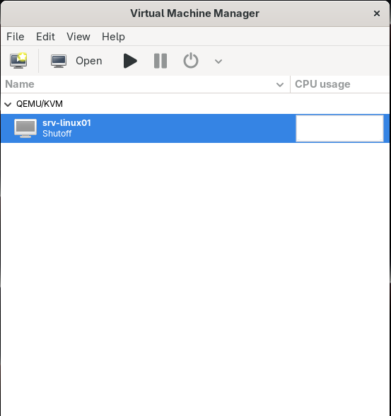
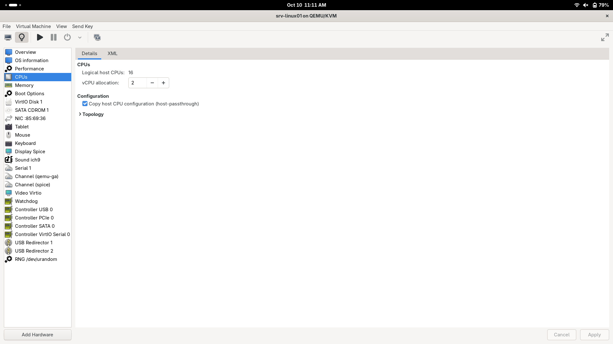
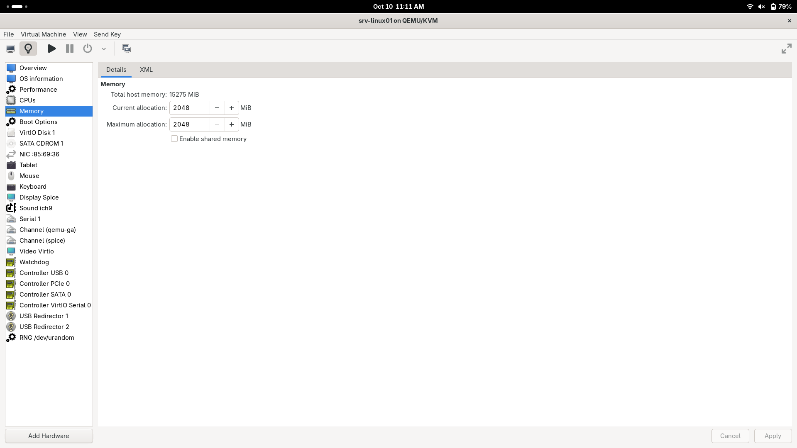
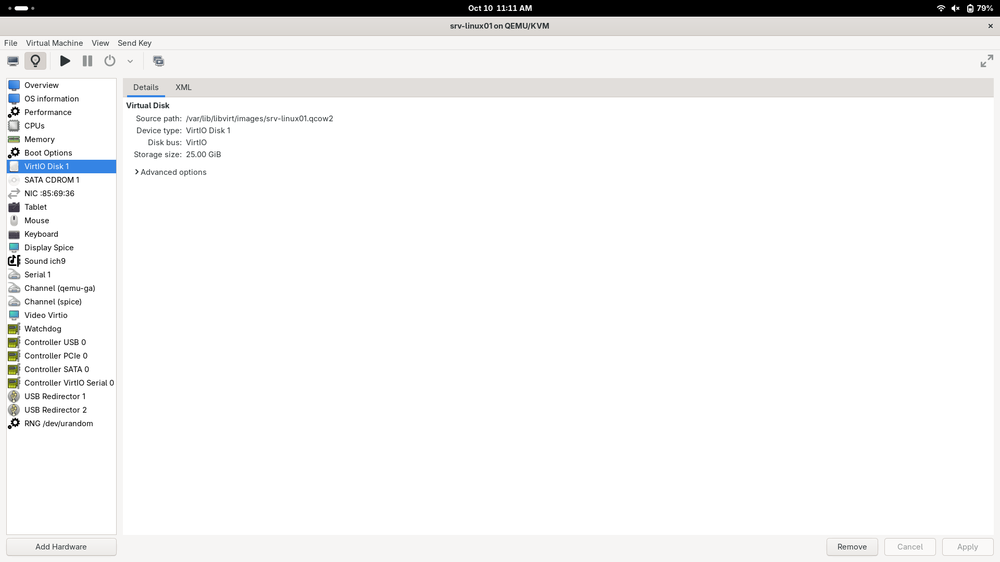
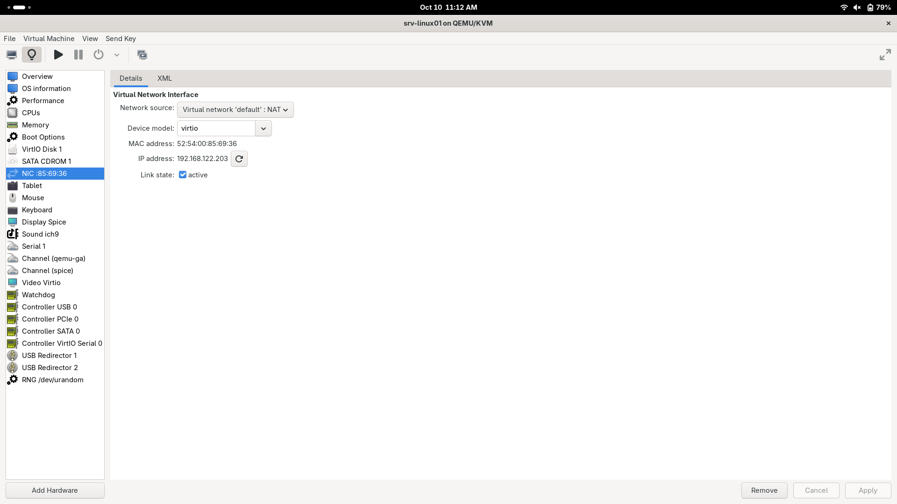
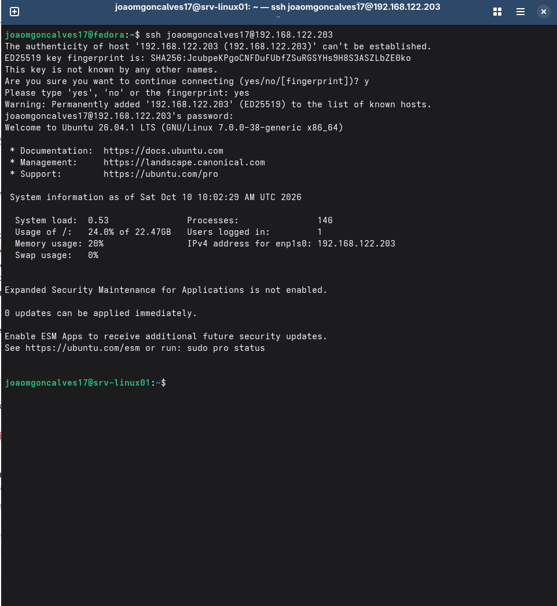
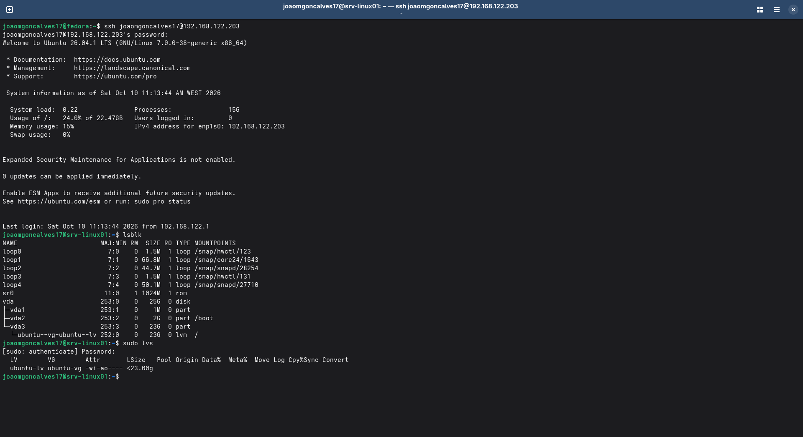
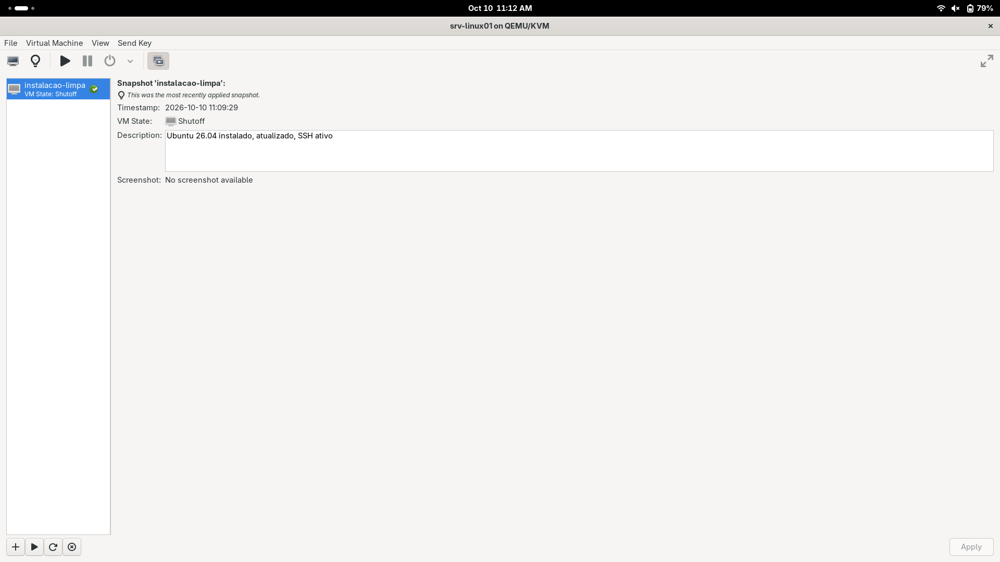

# Módulo 0 – Base do laboratório

## Objetivo
Preparar o portátil para correr o laboratório em máquinas virtuais.

## Equipamento
- Portátil: Ryzen 7 7735HS, 16 GB RAM, Fedora 44
- Virtualização: KVM com virt-manager

## O que fiz
1. Instalei o KVM e o virt-manager no Fedora.
2. Criei a VM **srv-linux01** com Ubuntu Server 26.04 (2 CPU, 2 GB RAM, 25 GB de disco com LVM).
3. Ativei o SSH e liguei-me à VM a partir do Fedora.
4. Atualizei o sistema e acertei o fuso horário.
5. Criei um snapshot chamado `instalacao-limpa`.

## Prints

VM no virt-manager:

CPU da VM:

Memória da VM:

Disco da VM:

Rede da VM:

Primeiro acesso por SSH a partir do Fedora:

Partições e LVM:

Snapshot criado:

## Problemas
- O virt-manager não reconheceu o Ubuntu 26.04, por isso escolhi o sistema à mão.
- A VM estava em hora UTC. Corrigi com `sudo timedatectl set-timezone Europe/Lisbon`.

## O que aprendi
- A diferença entre redes NAT, isoladas e bridge no virt-manager.
- O que é o LVM e porque é útil em servidores.
- Um snapshot não é um backup porque fica no mesmo disco que a VM.
